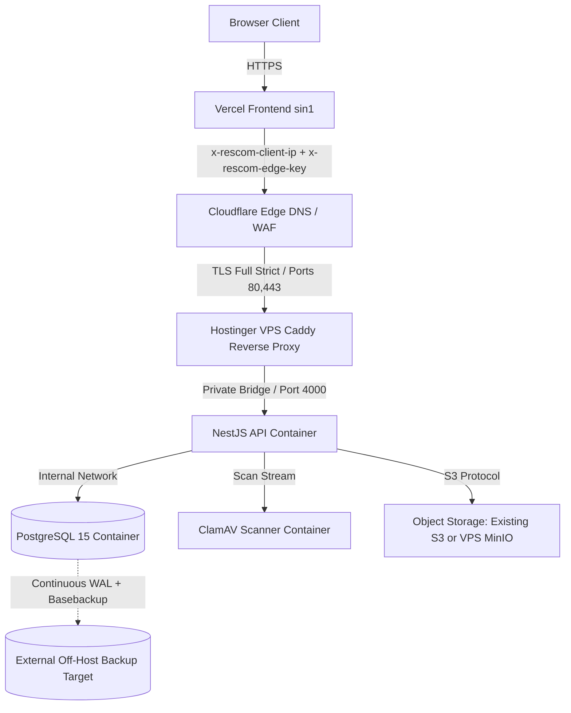

# Sprint Change Proposal: Hostinger VPS Topology & Storage Strategy (2026-10-04)

> **Status:** APPROVED 2026-10-05 by Quan (B1–B4 in §7.3). Story 11.2 and epics.md Story 11.2 updated. Measured inventory (`11-2-hostinger-evidence/00-read-only-inventory.md`) supersedes the reported 4 vCPU / "backend & PostgreSQL running" facts below; Stories 11.3–11.6 still need their own canonical edits.

## 1. Issue Summary & Hostinger Reality Baseline

### 1.1 Context & Reported Facts vs Operational Unknowns
- **Reported User Facts:** Owner operates an active Hostinger VPS (reported 4 vCPU, 8GB RAM, 100GB SSD) with backend and PostgreSQL already deployed via Docker Compose.
- **Operational Unknowns:** Host OS distribution, Linux kernel version, CPU architecture (x86_64 vs arm64), existing Docker Compose manifests and running container versions, live database schema and volume size, existing storage adapter/upload path, TLS cert bindings, live traffic, and external backup destination.
- **Single Failure Domain Risk:** Co-locating staging and production on one VPS shares kernel, memory, disk, and network. There is no physical blast-radius isolation. Headroom within 8GB RAM is tight; stress and staging integration tests must run sequentially. No capacity fits are assumed or promised.

### 1.2 Proposed Resource Budget & Capacity Model (Estimates Pending Measurement)

| Component | Proposed RAM Budget | Disk Reservation (Target) | Notes / Boundaries |
|:---|:---|:---|:---|
| **Host OS & System Buffers** | 1.0 GB | 15 GB (OS, system logs, base tools) | Baseline OS reservation |
| **PostgreSQL 15 Container** | 1.5 GB | 15 GB (Active PGDATA cluster) | Shared buffer / connection allocation |
| **ClamAV Scanner** | 1.5 GB | 5 GB (Signatures & engine temp) | Spikes during signature reload |
| **NestJS API (1 replica)** | 1.0 GB | 5 GB (Container image & runtime) | Single in-process scheduler |
| **Caddy Reverse Proxy** | 0.3 GB | 1 GB (Binary, certs, edge logs) | Edge TLS termination & header filter |
| ~~MinIO~~ | — | — | Rejected 2026-10-05 (B4): object storage on Cloudflare R2 |
| **WAL Archiving & Local Backups**| — | 15 GB (Local WAL buffer & dump scratch)| Staging buffer before off-host sync |
| **Staging Environment Headroom** | 1.5 GB | 15 GB (Sequential integration run) | Run sequentially to avoid OOM |
| **Unallocated Disk / Buffer** | — | 9 GB | Buffer to 100 GB SSD total |
| **Estimated Total** | **7.3 GB proposed** | **100 GB total** | Proposals only; requires live load audit |

### 1.3 Mandatory Non-Destructive Pre-Flight Invariant
Before modifying any running container, network bridge, Docker volume, domain/DNS binding, or running Prisma migrations, AGY must execute a consistent `pg_dump` (including global roles/definitions as needed) or `pg_basebackup` + WAL. Live `PGDATA` must NEVER be archived as a valid backup (cold file copies are permitted only after an approved clean PostgreSQL shutdown). Any scratch restore drill must execute strictly in an isolated scratch container and must never overwrite the active database.

---

## 2. Storage Strategy & Cloudinary Feasibility Assessment

### 2.1 Cloudinary Analysis (Official Documentation)
- **File Size Restrictions:** Official limits ([Cloudinary Pricing Plans](https://cloudinary.com/pricing/compare-plans)) restrict Free tier raw/image assets to 10 MB per file. RESCOM requires up to 50 MB for survey attachments (IR.5 / DF9). Automatic feature reduction to 10 MB is unacceptable without owner scope approval.
- **Non-Drop-In API Protocol:** Cloudinary relies on proprietary REST/SDK APIs ([Cloudinary Upload API](https://cloudinary.com/documentation/upload_images)) rather than standard S3 endpoints. It is not a drop-in environment variable swap for the `@aws-sdk/client-s3` adapter implemented in Story 11.1.
- **Security & Pipeline Friction:** Access gating requires private/authenticated delivery tokens ([Cloudinary Media Access Control](https://cloudinary.com/documentation/control_access_to_media)), custom presigned upload handlers, and rewriting the ClamAV quarantine and scanning pipeline.
- **Implementation & Schema Impact:** Adopting Cloudinary would require building a custom storage port adapter, and analysis indicates `StoredObject` schema or metadata changes may be needed.
- **Recommendation:** Recommend avoiding Cloudinary for core 50 MB survey uploads; maintain provider-neutral S3 interface.

### 2.2 Storage Option Comparison

| Dimension | Existing S3 Bucket (Priority 1) | VPS-Hosted MinIO (Priority 2) | Cloudinary (Not Recommended for Core) |
|:---|:---|:---|:---|
| **S3 Protocol Compatibility** | Native (`@aws-sdk/client-s3`) | Native (`@aws-sdk/client-s3`) | Non-drop-in (Proprietary SDK/API) |
| **50 MB File Upload Support** | Supported out-of-the-box | Supported (Local disk bound) | Exceeds 10 MB Free tier limit |
| **ClamAV Integration Flow** | Clean stream from bucket | Clean stream from local volume | Complex token / webhook bridge |
| **Local VPS RAM / Disk Impact** | Zero VPS footprint | Requires ~0.5 GB RAM + ~20 GB disk| Zero VPS footprint |
| **Presigned URL & CORS** | Standard S3 Presigned URL | Supported with Caddy reverse proxy | Custom signed upload authorization |

---

## 3. Database & Disaster Recovery: Hypervisor Snapshot vs Real PITR

### 3.1 Hostinger Snapshots vs Real PostgreSQL PITR

| Dimension | Hostinger VPS Snapshot / Backup | Real PostgreSQL WAL PITR (Proposed) |
|:---|:---|:---|
| **Official Documentation** | [Hostinger Backups](https://support.hostinger.com/en/articles/1583232-how-to-back-up-or-restore-a-vps) & [Dashboard Guide](https://www.hostinger.com/support/5726606-how-to-use-the-vps-dashboard-in-hostinger/) | PostgreSQL 15 WAL Archiving + `pg_basebackup` |
| **Actual Plan & Schedule** | Plan-dependent (inspect hPanel for enabled daily/weekly setting)| Continuous WAL shipping to independent off-host target |
| **Granularity / Scope** | Whole-VPS image restore (replaces entire system disk) | Cluster-level recovery into an isolated scratch instance |
| **Target Extraction** | Restores whole machine (high blast radius) | Restores scratch cluster, then exports selected database |
| **PITR Capability** | Snapshot restore only; no transaction-level replay | Replays WAL up to specific timestamp/transaction |

### 3.2 Recovery Workflow & Proposed Objectives
- **Cluster Restore to Scratch:** PostgreSQL WAL PITR restores the entire cluster to an isolated scratch container at the target timestamp. The specific database is then logically verified and exported as needed, ensuring zero mutation of the running production database.
- **Proposed Objectives (Pending Owner Approval):** Target RPO = 15 minutes; target RTO = 4 hours. Contingent upon owner selecting and provisioning an external off-host storage destination.
- **Dump-Only Warning:** A periodic `pg_dump` schedule is acceptable only as an interim safeguard; it cannot satisfy Story 11.4 PITR acceptance criteria without an explicit owner deviation waiver.

---

## 4. Target Architecture & Topology



### Unchanged Core Invariants
- **Vercel Frontend:** Serves `app.rescom.com.vn` (region `sin1`), rewrites `/api/*` to Cloudflare edge.
- **Cloudflare & Edge Ingress:** Strict TLS with Origin CA; Caddy validates `x-rescom-edge-key` and extracts `x-rescom-client-ip` with `TRUST_PROXY_HOPS=1`.
- **Identity & Governance:** Google OAuth separate credentials per environment; external SMTP; single in-process scheduler; AD-21 and IR.6 launch gates intact.

---

## 5. Explicit Artifact & Story Amendments (Proposed Diffs)

> Authoritative Paths: Architecture Spine (`_bmad-output/planning-artifacts/architecture/architecture-project-rescom-2026-08-08/ARCHITECTURE-SPINE.md`), PRD (`_bmad-output/planning-artifacts/prds/prd-project-rescom-2026-08-08/prd.md` & `addendum.md`), Epics (`_bmad-output/planning-artifacts/epics.md`), Summary (`PROJECT_SUMMARY.md`).

### 5.1 Architecture Spine AD-23 & PRD Platform Amendment
- **Status:** Proposed amendment only (extends the three-container baseline to include a private containerized PG15 and conditional storage; not yet approved canonical architecture).
- **OLD:** Pilot hosted on Google Cloud Compute Engine VM (`asia-southeast1`) with managed Cloud SQL and Google Cloud Storage S3 interoperability.
- **NEW:** Pilot hosted on existing Hostinger VPS (4 vCPU, 8GB RAM, 100GB SSD, Docker Compose). Backend runs Caddy, NestJS API, ClamAV, and private PostgreSQL 15 container with durable volume. Storage utilizes existing S3-compatible service or conditional local MinIO. Off-host backup pipeline ships WAL logs externally. GCP trial references removed.

### 5.2 Story 11.2: Infrastructure Provisioning
- **OLD (epics.md lines 1384–1388):**
  - Given a Google Cloud project on trial billing account in `asia-southeast1`.
  - Cloud SQL for PostgreSQL has private IP only, automated backups, and point-in-time recovery.
  - One private Cloud Storage bucket per environment with HMAC credentials and CORS.
- **NEW (Proposed Hostinger VPS ACs):**
  - Given the existing Hostinger VPS running Docker Compose.
  - PostgreSQL 15 runs in a private Docker network with durable host mounts, unexposed to public ports; `prisma migrate deploy` applied.
  - One private S3-compatible bucket exists (existing external S3 or conditional local MinIO) passing Story 11.1 AC7 smoke test.
  - Caddy uses Cloudflare Origin CA certificate; firewall allows 80/443 only from Cloudflare IP ranges; SSH uses key auth only.

### 5.3 Story 11.3: CI/CD Pipeline & Stateful Rollback
- **OLD:** SSH deployment pulls GHCR image, runs `prisma migrate deploy`, restarts container on GCP VM.
- **NEW:** Retain GHCR + SSH deployment workflow. Add mandatory pre-deployment automated database backup step. Rollback handles stateful container safeguards: image tag rollback must not downgrade schema without verified forward-fix.

### 5.4 Story 11.4: Observability, Alerting & PITR Drill
- **OLD (epics.md lines 1425–1426):**
  - Cloud SQL backup failures, database connectivity, VM disk above 80%, and ClamAV health raise alerts.
  - One point-in-time restore of Cloud SQL into a scratch instance performed; RPO/RTO proposed.
- **NEW (Proposed Hostinger VPS ACs):**
  - Alerts raise on VPS disk >80%, memory exhaustion, database connectivity, and WAL archiving failures.
  - Cluster PITR restore drill from off-host WAL + basebackup into a local scratch container performed, verified, and documented (RPO 15m, RTO 4h).

### 5.5 Story 11.5 & Story 11.6: Launch Readiness & Capacity Review
- **Story 11.5 (Launch Gates):** Dark deploy and cohort smoke tests execute on VPS; enforce Story 11.5 ACs: AD-21 privacy register sign-off, 2 active ADMIN accounts (decision E8-D3 forbidding self-moderation/self-approval), and real bank configuration.
- **Story 11.6 (Post-Launch Review):** Remove Day-70 GCP trial calendar trigger. Replace with post-pilot hosting review based on actual measured VPS resource utilization and contract renewal pricing prior to general availability.
- **Story 11.1:** Retained as DONE (packaging remains provider-neutral).

---

## 6. Implementation Plan, Cost Model & Next Bounded Task

### 6.1 Phased Implementation & Exit Gates
- **Phase 0 — Read-Only Inventory (1h):** Audit host OS, kernel, architecture, running compose services. *Exit Gate:* Baseline hardware/container state captured without secret exposure.
- **Phase 1 — Data Safety & Scratch Drill (2h):** Perform consistent `pg_dump` or clean cold copy; execute restore in scratch container. *Exit Gate:* Scratch restore verified; active DB untouched.
- **Phase 2 — Isolated Staging Verification (3h):** Deploy isolated staging environment. *Exit Gate:* S3 storage passes Story 11.1 AC7 upload smoke; 50 MB upload passes ClamAV (clean accepted, infected rejected, unauthorized denied, scanner outage fails closed); edge verification proves client IP restoration and spoof rejection; Google OAuth, CSRF token rotation, and SMTP dispatch succeed.
- **Phase 3 — Governance & Production Launch Gates (2h):** Dark deploy production API behind Caddy. *Exit Gate:* G5/IR.6 staging evidence pack signed; AD-21 privacy register approved by Product + Legal; dark deploy smoke passes before opening limited cohort; zero modification to live traffic before gates pass.

### 6.2 Roles & Operational Handoff

| Role | Entity | Primary Responsibilities |
|:---|:---|:---|
| **Project Owner** | Quan | References existing SSH config/key (no credentials in chat), selects off-host backup destination, signs off RPO/RTO. |
| **Developer Agent** | AGY | Prepares non-destructive scripts, configures compose stack, runs staging smoke, updates documentation. |
| **Supervisor Agent** | Codex | Reviews change proposals, verifies evidence gates, enforces architecture invariants. |

### 6.3 Cost Model (Estimates Pending Provider Invoices)
- **VPS Compute:** $0 incremental (existing owned VPS). Hostinger contract renewal cost pending owner billing record.
- **Backups & Egress:** Hostinger automated backup addon (conditional on hPanel plan); off-host S3 storage/egress pricing dependent on selected provider.
- **External Services:** Vercel, Cloudflare, Google OAuth, and SMTP usage subject to vendor tier limits and policies (no unconditional free guarantees).

### 6.4 Next Bounded AGY Task: Read-Only VPS Inventory
Using existing local SSH config/key references, execute strictly read-only commands without dumping secrets or environment configs (`rtk proxy` locally or direct shell on VPS; no VPS `rtk` installation needed):
```bash
uname -a && lscpu && free -h && df -h
docker ps --format "table {{.Names}}\t{{.Image}}\t{{.Status}}\t{{.Ports}}"
docker volume ls
```

---

## 7. Owner Decision Log & Checklist Status

### 7.1 Pending Owner Inputs
- **B1 (Current State):** Provide output of read-only inventory commands from VPS.
- **B2 (Off-Host Storage Target):** Specify off-host storage target (AWS S3, Cloudflare R2, or remote SFTP) for WAL archives.
- **B3 (Disaster Recovery Approval):** Formally approve proposed RPO (15 min) and RTO (4 h) targets.
- **B4 (File Storage Choice):** Confirm reuse of existing S3 bucket or approval of conditional VPS-hosted MinIO.

### 7.2 BMAD Checklist Status
- [x] Trigger & Context Analyzed (GCP blocked, existing Hostinger VPS identified)
- [x] Technical & Cost Constraints Verified (Cloudinary limitations identified, single failure domain assessed)
- [x] Story & Architecture Diff Drafted (Stories 11.2–11.6, AD-23 updated)
- [!] Owner Decision Blockers Pending (B1–B4 required before canonical document edits)

### 7.3 Owner Decisions (Quan, 2026-10-05)
- **B1 — Greenfield:** Measured inventory is accepted. The VPS has no containers, volumes or live data, and no RESCOM data exists elsewhere. The §1.3 pre-flight `pg_dump` and scratch restore before first deploy are not applicable. The invariant applies from the first real deployment onward. Capacity planning uses **2 vCPU / 7.8 GiB / 0 swap**: add a swapfile and run builds and ClamAV reloads off the API's peak path.
- **B2 — Off-host backup target:** Cloudflare R2. Use a dedicated bucket for WAL archives and base backups, with its own scoped API token.
- **B3 — DR objectives:** Approved for the pilot. RPO is 15 minutes and RTO is 4 hours, using WAL archiving plus base backup to R2. Story 11.4 performs the restore drill into a scratch container.
- **B4 — File storage:** Cloudflare R2 through the existing S3 adapter, with one private bucket per environment and no MinIO on the VPS. Run the Story 11.1 AC7 smoke against R2 first, including checksum mode, presigned PUT/GET, CORS, 50 MB uploads and the ClamAV flow. Fall back to MinIO only through a recorded deviation if R2 fails.
- **Domain (2026-10-05):** Canonical domain is `rescom.io.vn`, with `app.` for the frontend on Vercel, `api.` for the API edge, and `staging-app.` / `staging-api.` for staging. `rescom.com.vn` is dropped.
- **GCP (2026-10-05):** GCP is dropped entirely and is no longer a fallback or a post-pilot target. Epic 11 and AD-23 are updated accordingly.
