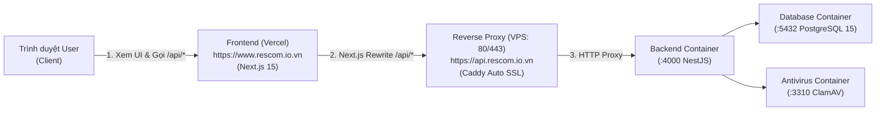

# HƯỚNG DẪN DEPLOY BACKEND LÊN VPS & KẾT NỐI VỚI FRONTEND (VERCEL)

Tài liệu này hướng dẫn chi tiết từ A-Z quy trình triển khai Backend NestJS lên Hostinger VPS, cấu hình HTTPS tự động với Caddy, và kết nối với Frontend Next.js 15 triển khai trên Vercel cho dự án **RESCOM**.

---

## MỤC LỤC

1. [Kiến trúc kết nối & Luồng hoạt động](#1-kiến-trúc-kết-nối--luồng-hoạt-động)
2. [Cấu hình Tên miền (DNS)](#2-cấu-hình-tên-miền-dns)
3. [Quy trình Deploy Backend lên Hostinger VPS](#3-quy-trình-deploy-backend-lên-hostinger-vps)
   - [3.1. Chuẩn bị VPS (Docker, Swap, UFW)](#31-chuẩn-bị-vps-docker-swap-ufw)
   - [3.2. Cấu hình file môi trường `.env.prod`](#32-cấu-hình-file-môi-trường-envprod)
   - [3.3. Khởi chạy hệ thống bằng Docker Compose](#33-khởi-chạy-hệ-thống-bằng-docker-compose)
   - [3.4. Kiểm tra sức khỏe Backend (Health Check)](#34-kiểm-tra-sức-khỏe-backend-health-check)
4. [Cấu hình Frontend trên Vercel để kết nối Backend](#4-cấu-hình-frontend-trên-vercel-để-kết-nối-backend)
   - [4.1. Thiết lập Project Settings](#41-thiết-lập-project-settings)
   - [4.2. Cấu hình Biến môi trường (Environment Variables)](#42-cấu-hình-biến-môi-trường-environment-variables)
   - [4.3. Cơ chế Reverse Proxy (Next.js Rewrites)](#43-cơ-chế-reverse-proxy-nextjs-rewrites)
5. [Quy trình Cập nhật Code (Redeploy Workflow)](#5-quy-trình-cập-nhật-code-redeploy-workflow)
6. [Xử lý Sự cố Thường gặp (Troubleshooting)](#6-xử-lý-sự-cố-thường-gặp-troubleshooting)

---

## 1. Kiến trúc kết nối & Luồng hoạt động



### Tại sao sử dụng kiến trúc Next.js Rewrites?
Thay vì trình duyệt gọi trực tiếp sang `https://api.rescom.io.vn`, Next.js trên Vercel đóng vai trò là một lớp Reverse Proxy:
1. **Không gặp lỗi CORS:** Trình duyệt chỉ gọi cùng origin `https://www.rescom.io.vn/api/...`.
2. **Cookie bảo mật tuyệt đối:** Các cookie phiên đăng nhập (`auth_session`) và CSRF token hoạt động mượt mà với cờ `SameSite=Lax` / `Strict` mà không bị trình duyệt chặn cross-site.
3. **Ẩn endpoint gốc của Backend:** Giảm thiểu nguy cơ tấn công DDoS trực tiếp vào VPS.

---

## 2. Cấu hình Tên miền (DNS)

Trên trang quản trị DNS (ví dụ: Cloudflare, Namecheap, Hostinger), tạo các bản ghi sau:

| Loại | Tên (Host) | Giá trị (Target) | Proxy Status | Mục đích |
|---|---|---|---|---|
| **A / CNAME** | `@` / `www` | `cname.vercel-dns.com` (hoặc `76.76.21.21`) | DNS only hoặc Proxied | Trỏ frontend về **Vercel** |
| **A** | `api` | `201.18.212.192` (IP VPS) | **DNS only (Mây xám)** | Endpoint API Backend cho Caddy |
| **A** | `s3` | `201.18.212.192` (IP VPS) | **DNS only (Mây xám)** | Endpoint Upload S3 / MinIO |

> [!IMPORTANT]
> Bản ghi `api` và `s3` **bắt buộc phải để DNS only (mây xám)** trên Cloudflare. Nếu bật mây cam (Proxied), Caddy trên VPS sẽ không thể xác thực ACME challenge để tự động cấp chứng chỉ SSL Let's Encrypt.

---

## 3. Quy trình Deploy Backend lên Hostinger VPS

### 3.1. Chuẩn bị VPS (Docker, Swap, UFW)
Khi nhận VPS mới (Debian / Ubuntu):

1. **Cài đặt Docker & Docker Compose:**
   ```bash
   curl -fsSL https://get.docker.com | sudo sh && sudo usermod -aG docker $USER
   ```
2. **Tạo Swap Memory (4GB)** *(rất quan trọng để tránh OOM khi ClamAV nạp cơ sở dữ liệu virus):*
   ```bash
   sudo fallocate -l 4G /swapfile && sudo chmod 600 /swapfile && sudo mkswap /swapfile && sudo swapon /swapfile
   echo '/swapfile none swap sw 0 0' | sudo tee -a /etc/fstab
   ```
3. **Mở cổng Firewall (UFW):**
   ```bash
   sudo ufw allow OpenSSH
   sudo ufw allow 80/tcp
   sudo ufw allow 443/tcp
   sudo ufw allow 443/udp
   sudo ufw enable
   ```

### 3.2. Cấu hình file môi trường `.env.prod`
1. Clone mã nguồn về VPS tại `/opt/rescom`:
   ```bash
   sudo mkdir -p /opt/rescom && sudo chown -R $USER:$USER /opt/rescom
   git clone -b develop https://github.com/qxh1145/project-rescom.git /opt/rescom
   ```
2. Tạo file `/opt/rescom/deploy/.env.prod`:
   ```bash
   cd /opt/rescom/deploy
   cp .env.prod.example .env.prod
   chmod 600 .env.prod
   nano .env.prod
   ```
3. Cập nhật các biến quan trọng trong `.env.prod`:
   ```env
   # --- Tên miền ---
   API_DOMAIN=api.rescom.io.vn
   S3_DOMAIN=s3.rescom.io.vn
   FRONTEND_ORIGINS=https://www.rescom.io.vn,https://rescom.io.vn

   # --- Database PostgreSQL ---
   POSTGRES_USER=rescom_admin
   POSTGRES_PASSWORD=<tao_mat_khau_ngau_nhien_o_day>
   POSTGRES_DB=rescom_db
   DATABASE_URL=postgresql://rescom_admin:<mat_khau_tren>@postgres:5432/rescom_db?schema=public&options=-c%20timezone%3DUTC

   # --- Security & JWT (Dùng: openssl rand -hex 32) ---
   JWT_SECRET=<chuoi_hex_32_ky_tu>
   AUTH_SECRET_PROTECTION_KEY=<chuoi_hex_32_ky_tu>
   COMPLETION_CODE_HMAC_SECRET=<chuoi_hex_32_ky_tu>
   STORAGE_CAPABILITY_SECRET=<chuoi_hex_32_ky_tu>

   # --- Email Brevo (Gửi mã xác nhận & thông báo) ---
   EMAIL_DELIVERY_MODE=smtp
   EMAIL_FROM=Rescom <no-reply@rescom.io.vn>
   SMTP_HOST=smtp-relay.brevo.com
   SMTP_PORT=587
   SMTP_USERNAME=<tai_khoan_brevo>
   SMTP_PASSWORD=<master_key_smtp_brevo>
   ```

### 3.3. Khởi chạy hệ thống bằng Docker Compose
Tại thư mục `/opt/rescom/deploy`:
```bash
docker compose -f docker-compose.hostinger.yml --env-file .env.prod up -d --build
```
Lệnh này sẽ tự động:
1. Build image Backend từ `deploy/backend.Dockerfile`.
2. Khởi chạy Postgres 15 và ClamAV.
3. Chờ Postgres healthy, tự động chạy `npx prisma migrate deploy` để migrate database.
4. Chạy NestJS backend trên cổng nội bộ `4000`.
5. Caddy khởi động trên cổng `80/443`, tự động liên hệ Let's Encrypt cấp SSL cho `api.rescom.io.vn` và reverse proxy request vào container backend.

### 3.4. Kiểm tra sức khỏe Backend (Health Check)
Chạy lệnh kiểm tra từ máy bất kỳ:
```bash
curl -I https://api.rescom.io.vn/health/live
```
**Kết quả mong đợi:** `HTTP/2 200` kèm JSON `{"status":"ok"}`.

---

## 4. Cấu hình Frontend trên Vercel để kết nối Backend

### 4.1. Thiết lập Project Settings trên Vercel
1. Đăng nhập Vercel ➔ Chọn Project Frontend.
2. Vào **Settings** ➔ **General**:
   - **Root Directory:** Chọn `apps/frontend/my-app` (hoặc `apps/frontend` tùy cấu trúc monorepo của bạn).
   - **Framework Preset:** Next.js.
   - **Build Command:** `npm run build` (hoặc cấu hình turborepo).

### 4.2. Cấu hình Biến môi trường (Environment Variables)
Vào tab **Settings** ➔ **Environment Variables**, thêm các biến sau cho cả 3 môi trường (*Production*, *Preview*, *Development*):

| Tên biến | Giá trị | Ý nghĩa |
|---|---|---|
| `RESCOM_API_URL` | `https://api.rescom.io.vn` | Địa chỉ backend thật trên VPS để Next.js rewrite |
| `NEXT_PUBLIC_API_MOCKING` | `disabled` | **Bắt buộc:** Tắt hoàn toàn MSW mock, gọi backend thật |
| `NEXT_PUBLIC_PILOT_BUILD` | `true` | Cờ kích hoạt tính năng chuẩn Pilot |
| `NEXT_PUBLIC_APP_URL` | `https://www.rescom.io.vn` | Địa chỉ trang chủ frontend |

Sau khi lưu các biến môi trường, nhấn **Redeploy** trên Vercel để bản build áp dụng cấu hình mới.

### 4.3. Cơ chế Reverse Proxy (Next.js Rewrites)
Cơ chế này đã được cấu hình sẵn trong [`apps/frontend/my-app/next.config.ts`](file:///Users/quan/HocTap/Vibecode/project-rescom/apps/frontend/my-app/next.config.ts):
```typescript
async rewrites() {
  const apiBaseUrl = process.env.RESCOM_API_URL ?? "http://localhost:4000";
  return [
    {
      source: "/api/:path*",
      destination: `${apiBaseUrl.replace(/\/$/, "")}/:path*`,
    },
  ];
},
```
Khi người dùng truy cập `https://www.rescom.io.vn/api/auth/login`, Vercel sẽ tự động đứng ra làm proxy chuyển tiếp request tới `https://api.rescom.io.vn/auth/login`.

---

## 5. Quy trình Cập nhật Code (Redeploy Workflow)

### Cập nhật Backend khi có code mới
Mỗi khi có cập nhật code backend hoặc schema database:
```bash
ssh root@201.18.212.192 "cd /opt/rescom && git pull origin develop && docker compose -f deploy/docker-compose.hostinger.yml --env-file deploy/.env.prod up -d --build backend"
```
*(Container backend sẽ tự động build lại, chạy `prisma migrate deploy` và hot-swap không làm gián đoạn Caddy).*

### Cập nhật Frontend
Vercel đã tích hợp sẵn GitHub webhook:
- Bạn chỉ cần `git push origin develop` (hoặc merge vào branch chính).
- Vercel sẽ tự động kích hoạt pipeline build và phát hành phiên bản mới trong vòng 1-2 phút.

---

## 6. Xử lý Sự cố Thường gặp (Troubleshooting)

### 1. Gọi API từ Frontend bị lỗi 502 / 504 Bad Gateway
- **Nguyên nhân:** Backend container trên VPS bị chết hoặc chưa khởi động xong.
- **Cách xử lý:** SSH vào VPS và kiểm tra log backend:
  ```bash
  ssh root@201.18.212.192 "docker logs rescom-backend-1 --tail 50"
  ```
  Nếu thấy container restarting, kiểm tra kết nối Postgres hoặc bộ nhớ RAM (`free -h`).

### 2. Caddy không cấp phát được chứng chỉ SSL HTTPS cho `api.rescom.io.vn`
- **Nguyên nhân:** Tên miền đang bật Cloudflare proxy (mây cam).
- **Cách xử lý:** Vào Cloudflare DNS ➔ Đổi bản ghi `api` từ **Proxied (mây cam)** sang **DNS only (mây xám)**. Sau đó khởi động lại Caddy:
  ```bash
  ssh root@201.18.212.192 "docker restart rescom-caddy-1"
  ```

### 3. Đăng nhập thành công nhưng F5 bị mất phiên (Cookie không được lưu)
- **Nguyên nhân:** Trình duyệt chặn cookie bên thứ 3 nếu gọi trực tiếp khác domain.
- **Cách xử lý:** Đảm bảo toàn bộ request API trong code Frontend đều gọi URL tương đối `/api/...` (để đi qua Vercel rewrites), tuyệt đối không hardcode URL tuyệt đối `https://api.rescom.io.vn/...` trong code giao diện client.

### 4. Kiểm tra toàn bộ dịch vụ đang chạy trên VPS
```bash
ssh root@201.18.212.192 "docker compose -f /opt/rescom/deploy/docker-compose.hostinger.yml --env-file /opt/rescom/deploy/.env.prod ps"
```
Cả 4 container (`caddy`, `backend`, `postgres`, `clamav`) đều phải có trạng thái **`Up (healthy)`**.
